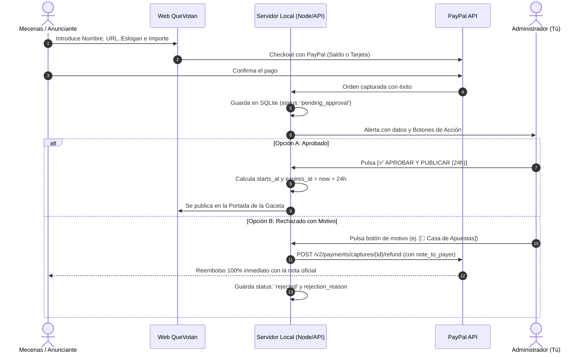

# 🏛️ Plan de Desarrollo: «El Mecenas de la Gaceta» (Subasta con PayPal)

> **Misión y Filosofía:** Permitir a lectores, pequeños comercios, profesionales de oficio y proyectos verdaderamente útiles patrocinar la gaceta cívica mediante una subasta ascendente por micropagos con **PayPal**.  
> El sistema se rige por **estricta privacidad y cumplimiento del RGPD**, **garantía de permanencia mínima de 24 horas**, un **archivo histórico de los últimos 10 mecenas**, y **moderación manual obligatoria con motivos predefinidos de rechazo y reembolso automático**.

---

## 🧭 1. Manifiesto Editorial: Solo Productos y Proyectos Útiles

En coherencia con la vocación cívica y neutral de **QueVotan**, el patrocinio está concebido para apoyar la economía real y proyectos con valor tangible:

| Colectivos Bienvenidos 🟢 | Veto y Rechazo Taxativo 🔴 |
| :--- | :--- |
| **Autónomos y Oficios:** Carpinteros, fontaneros, cerrajeros, electricistas, diseñadores, ilustradores, mecánicos, traductores... | **Juegos de Azar y Apuestas:** Casas de apuestas deportivas, casinos online, póker o loterías. |
| **Comercio Local y Proximidad:** Librerías de barrio, panaderías artesanas, zapaterías, talleres, cooperativas agrícolas... | **Especulación Financiera:** Criptomonedas, tokens, NFTs, bots de trading, plataformas Forex o esquemas piramidales. |
| **Software y Cultura:** Proyectos de código abierto, herramientas ciudadanas, podcasts independientes, ensayos, libros, blogs técnicos... | **Cursos «Vendehumos»:** Promesas de «hacerse rico sin esfuerzo», másteres milagro, mentalidad millonaria o *lifestyle coaching* abusivo. |
| **Proyectos Sociales y Vecinales:** Asociaciones culturales, divulgación científica, defensa del patrimonio, comedores sociales... | **Propaganda Partidista:** Campañas electorales, consignas partidistas directas o ataques de descrédito a candidatos. |

---

## 🛡️ 2. Privacidad y Cumplimiento Estricto del RGPD (Cero Datos Innecesarios)

QueVotan aplica el **Principio de Minimización de Datos** (Art. 5.1.c RGPD / LOPDGDD 3/2018):

1. **Datos que SÍ se registran (Públicos por definición):**
   * **Nombre público** o marca comercial (máx. 40 caracteres).
   * **Enlace web** de destino (`https://...`).
   * **Eslogan o mensaje público** que aparecerá en portada (máx. 90 caracteres).
   * **Importe aportado** (para el cómputo transparente de la subasta).
2. **Datos que NO se almacenan en nuestros servidores:**
   * ❌ **Cero datos bancarios o números de tarjeta:** La pasarela se ejecuta al 100% en los servidores bancarios certificados PCI-DSS de PayPal.
   * ❌ **Cero DNI, domicilios postales o teléfonos.**
   * ❌ **Cero cookies de seguimiento publicitario (Zero-Cookies):** El patrocinio es un enlace HTML limpio con atributo `rel="noopener sponsored"`, sin píxeles de rastreo de terceros ni analítica invasiva.
3. **Tratamiento del correo devuelto por PayPal:**
   * El email del pagador devuelto por la API de PayPal **únicamente se utiliza en memoria** para identificar la orden y ejecutar el reembolso si se rechaza. No se vende, no se crean listas de correo (*mailing*) y no se perfila.
4. **Marco Legal en la Gaceta:**
   * Actualización del pliego [src/components/LegalModal/LegalModal.tsx](file:///opt/quevotan/src/components/LegalModal/LegalModal.tsx) añadiendo la cláusula específica de transparencia para mecenas cívicos.

---

## 🎯 3. Reglas de Negocio de la Subasta

| Regla | Especificación |
| :--- | :--- |
| **Mecánica de Subasta** | Sistema ascendente (*King of the Hill*). La puja de partida es **1,00 €**. Cada nueva puja debe superar a la activa en al menos **+1,00 €** (ej. 2 €, 5 €, 15 €...). |
| **Garantía de Permanencia** | **24 horas ininterrumpidas** garantizadas desde el instante en que el administrador aprueba el anuncio. |
| **Cola de Relevo Inteligente** | Si entra una puja superior mientras el mecenas actual está disfrutando de sus 24 horas y es aprobada, queda **programada en cola** y toma el relevo exacto al expirar las 24 horas del anterior. Si ya han pasado las 24 horas, entra de inmediato. |
| **Historial de los 10 Últimos** | Listado de honor cívico en la portada que recuerda a los últimos 10 benefactores (fecha, nombre, importe y enlace permanente). |
| **Filtro de Neutralidad** | El anuncio **nunca se publica automáticamente**. Queda en estado `pending_approval`. Si el administrador lo rechaza, la API de PayPal ejecuta el **reembolso automático del 100%** al comprador. |

---

## ⚙️ 4. Flujo de Moderación con Botones de Rechazo Predefinidos

Para moderar en **1 segundo desde tu teléfono móvil o panel**, al entrar un patrocinio el sistema te presenta la ficha con botones de aprobación y motivos predefinidos de rechazo:



### 🔘 Botones Predefinidos de Rechazo:
1. `[🎰 Rechazar: Apuestas / Casinos]` ➡️ *"No admitimos negocios de juego de azar ni apuestas en nuestra gaceta."*
2. `[🪙 Rechazar: Criptomonedas / Trading]` ➡️ *"No publicamos proyectos de especulación financiera, criptomonedas ni trading."*
3. `[📢 Rechazar: Curso Vendehumos]` ➡️ *"Solo aceptamos proyectos y productos útiles; no admitimos fórmulas de enriquecimiento rápido."*
4. `[⚖️ Rechazar: Propaganda Partidista]` ➡️ *"QueVotan mantiene una estricta neutralidad parlamentaria; no admitimos consignas políticas."*
5. `[⚠️ Rechazar: Enlace Sospechoso / Spam]` ➡️ *"El enlace o contenido proporcionado no cumple nuestros estándares de seguridad."*
6. `[✏️ Rechazar: Texto Inapropiado]` ➡️ *"El texto remitido vulnera las normas básicas de respeto de la comunidad."*

> [!TIP]
> Al pulsar cualquiera de estos botones, el backend envía el motivo en el parámetro oficial `note_to_payer` de la API de reembolso de PayPal. El comprador recibe un correo oficial de PayPal con la devolución íntegra de su dinero y la explicación respetuosa de por qué no encaja en la línea editorial.

---

## 🗄️ 5. Modelo de Datos SQLite ([data/quevotan.db](file:///opt/quevotan/data/quevotan.db))

Tabla `sponsors` reforzada:

```sql
CREATE TABLE IF NOT EXISTS sponsors (
    id TEXT PRIMARY KEY,                       -- spon_20261114_xxxx
    name TEXT NOT NULL,                        -- Nombre o Empresa (máx 40 car.)
    url TEXT NOT NULL,                         -- URL con HTTPS validada
    message TEXT NOT NULL,                     -- Texto de la mención (máx 90 car.)
    amount_cents INTEGER NOT NULL,             -- Importe en céntimos (ej. 500 = 5.00 €)
    currency TEXT DEFAULT 'EUR',
    status TEXT DEFAULT 'pending_approval',   -- 'pending_approval', 'queued', 'active', 'archived', 'rejected'
    rejection_reason TEXT,                     -- Motivo predefinido en caso de rechazo
    paypal_order_id TEXT UNIQUE,               -- ID de la orden en PayPal
    paypal_capture_id TEXT UNIQUE,             -- ID de captura para reembolsos automáticos
    approved_at TEXT,                          -- Timestamp de aprobación
    starts_at TEXT,                            -- Inicio del periodo de 24h
    expires_at TEXT,                           -- Fin del periodo de 24h
    created_at TEXT DEFAULT CURRENT_TIMESTAMP
);

CREATE INDEX IF NOT EXISTS idx_sponsors_status ON sponsors(status);
CREATE INDEX IF NOT EXISTS idx_sponsors_expires ON sponsors(expires_at);
```

---

## 🎨 6. Diseño del Grabado Litográfico en Portada

Ubicado en la portada ([src/App.tsx](file:///opt/quevotan/src/App.tsx)) bajo la estética editorial clásica:

```
┌─────────────────────────────────────────────────────────────────────────────┐
│ ✦ AVISO AL PÚBLICO • MECENAS CÍVICO DE ESTA EDICIÓN                      [?]│
│ ─────────────────────────────────────────────────────────────────────────── │
│ «Esta edición cívica está auspiciada por La Carpintería García — Muebles    │
│  a medida y restauración tradicional. Visite su taller en garciataller.es»  │
│                                                                             │
│ ⏳ Edición garantizada: 14h 20m restantes   │   Puja actual: 6,00 €         │
│ ─────────────────────────────────────────────────────────────────────────── │
│ [✦ Sobrepujar y ser el próximo mecenas (Mín. 7 €) →]  [📜 Ver 10 anteriores]│
└─────────────────────────────────────────────────────────────────────────────┘
```

* **Modal de Puja Cívica:**
  * Declaración clara de principios: *"Solo proyectos útiles, autónomos y economía real. Rechazo automático a apuestas, cripto y vendehumos"*.
  * Campos: Nombre público, enlace seguro `https://`, mensaje sintético (contador de 90 caracteres).
  * Vista previa en directo con tipografía de prensa.
  * Botón oficial de PayPal Checkout.
* **Hemeroteca de los 10 Mecenas:**
  * Desplegable con tabla mecanografiada: fecha, mecenas, aportación e hipervínculo con `rel="noopener sponsored"`.

---

## 🚀 7. Fases de Ejecución

```
Fase 1: SQLite y Capa de Datos (RGPD Friendly)
  ├── Creación de tabla `sponsors` en data/quevotan.db
  └── Métodos en server/dbService.ts (getActiveSponsor, getSponsorHistory, expireOldSponsors)

Fase 2: Componentes UI de Portada y Modales
  ├── src/components/Mecenas/MecenasBox.tsx (Grabado litográfico y contador 24h)
  ├── src/components/Mecenas/MecenasModal.tsx (Formulario cívico + Preview en tiempo real)
  ├── src/components/Mecenas/MecenasHistory.tsx (Archivo histórico de 10 benefactores)
  └── Actualización de LegalModal.tsx con cláusula de mecenazgo y privacidad

Fase 3: Servicio de Integración PayPal
  ├── server/paypalService.ts (Creación de orden, captura y reembolso con note_to_payer)
  └── Endpoints API en vite.config.ts (/api/sponsors/*)

Fase 4: Flujo de Aprobación Rápida con Botones de Rechazo
  ├── Bot de Telegram / Panel web privado con botones predefinidos
  └── Reembolso automático instantáneo al pulsar un motivo

Fase 5: Verificación, Quórums y Build de Producción
  ├── Pruebas con cuentas ficticias de PayPal Sandbox
  ├── Comprobación de que pnpm build, pnpm lint y pnpm test pasen al 100%
```
